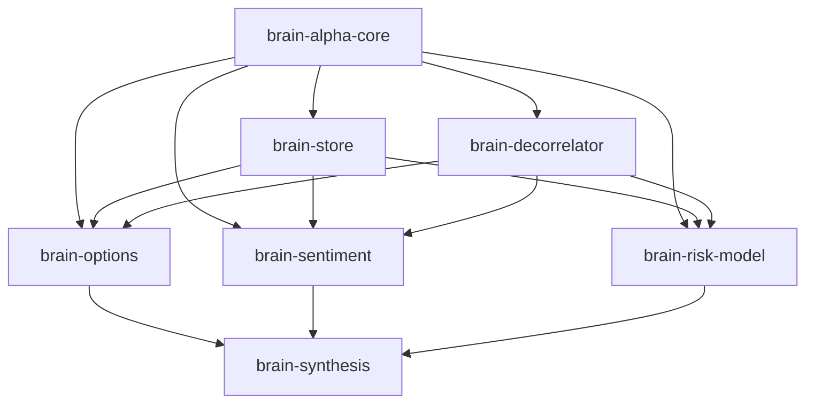

# Brain Alpha Pipeline — Modular Library Suite

A suite of 7 pip-installable Python libraries for WorldQuant BRAIN alpha discovery, orthogonal decorrelation, and tri-factor meta-synthesis.

[](https://github.com/Xtley001/brain-libraries/actions)
[](./LICENSE)
[](https://www.python.org/downloads/)
[](https://pypi.org/project/brain-synthesis/)
[](#package-index)

The `brain_libraries` suite decouples the WorldQuant BRAIN quantitative research workflow into 7 independent, fully tested Python packages. It covers type contracts, dual-mode state storage, strategy-agnostic orthogonal decorrelation (AST motifs & Veto memory), domain engines (Options, Sentiment, Risk Models), and an apex meta-synthesis CLI with Hierarchical Risk Parity (HRP). For the underlying quantitative methodology, see each library's linked whitepaper.

## Installation

```bash
# Install the entire suite and global 'brain' CLI
pip install brain-synthesis

# Or install individual libraries as needed
pip install brain-decorrelator
pip install brain-options
pip install brain-sentiment
pip install brain-risk-model
```

## Quickstart

```bash
# Generate alpha candidates across all data domains
brain generate --domain all --count 3

# Apply 10-axis orthogonal decorrelation to break correlation (|rho| < 0.70)
brain decorrelate "rank(implied_volatility_call_30)" --base-sharpe 1.55

# Inspect storage health and cache counts
brain store
```

## Who Is This For

If you are developing a WorldQuant BRAIN alpha generation and research pipeline in Python and need:
- **High-Value Alpha Discovery**: Systematic signal mining across options implied volatility, analyst earnings revisions, and systematic risk premia.
- **Correlation Gate Clearance**: Break platform correlation gates ($|\rho| < 0.70$) without sacrificing Sharpe using 10-axis orthogonal decorrelation, AST-diff motif mining, and asymmetric veto memory.
- **Tri-Factor Meta-Synthesis**: Cross-domain signal fusion combining options, sentiment, and risk models into 8 golden apex alphas using Hierarchical Risk Parity (HRP) yielding 1,600+ platform points.
## Quantitative Research Masterclass

A 5-part technical masterclass series demonstrating the econometric theory and empirical mechanics behind the suite:

1. [**Beating the Correlation Gatekeeper ($|\rho| < 0.70$)**](articles/01_beating_the_correlation_gate.md) — 10 orthogonal axes, AST-diff motifs, and asymmetric veto memory.
2. [**Fixing `LOW_SUB_UNIVERSE_SHARPE` Once and for All**](articles/02_fixing_low_sub_universe_sharpe.md) — Sub-industry vector neutralization eliminating unintended sector bets.
3. [**Taming the Turnover Trap ($< 12\%$)**](articles/03_taming_the_turnover_trap.md) — PEAD drift half-life matching and SUE surprise normalization.
4. [**Escaping the Price-Volume Trap**](articles/04_escaping_price_volume_trap.md) — Extracting high-value (ValueScore: 6.0) options surface signals.
5. [**The 1,500+ Point Blueprint**](articles/05_building_1500_point_meta_alphas.md) — Fusing Options, Sentiment, and Risk Models via Hierarchical Risk Parity (HRP).

*See the [Series Overview & Roadmap](articles/README.md) for complete publication metadata and Medium distribution details.*

## Package Index

| Library | PyPI Package | Version | Total Downloads | Description | Whitepaper |
|---|---|:---:|:---:|---|---|
| [`brain_core`](brain_core/) | [`brain-alpha-core`](https://pypi.org/project/brain-alpha-core/) | `0.1.0` | [](https://pepy.tech/projects/brain-alpha-core) | Shared types, config loader, logging, AST deduplication | [Whitepaper](brain_core/docs/whitepaper.md) |
| [`brain_store`](brain_store/) | [`brain-store`](https://pypi.org/project/brain-store/) | `0.1.0` | [](https://pepy.tech/projects/brain-store) | PostgreSQL connection pool + flat-file dual-mode persistence | [Schema & Migrations](brain_store/docs/SCHEMA_AND_MIGRATIONS.md) |
| [`brain_decorrelator`](brain_decorrelator/) | [`brain-decorrelator`](https://pypi.org/project/brain-decorrelator/) | `0.2.0` | [](https://pepy.tech/projects/brain-decorrelator) | 10-axis orthogonal decorrelation, AST motifs & Veto memory | [Axes Guide](brain_decorrelator/docs/AXES.md) |
| [`brain_options`](brain_options/) | [`brain-options`](https://pypi.org/project/brain-options/) | `0.1.0` | [](https://pepy.tech/projects/brain-options) | Options IV surfaces, term structure, and breakeven engine | [Whitepaper](brain_options/docs/whitepaper.md) |
| [`brain_sentiment`](brain_sentiment/) | [`brain-sentiment`](https://pypi.org/project/brain-sentiment/) | `0.1.0` | [](https://pepy.tech/projects/brain-sentiment) | PEAD, SUE surprises, and analyst revision diffusion engine | [Whitepaper](brain_sentiment/docs/whitepaper.md) |
| [`brain_risk_model`](brain_risk_model/) | [`brain-risk-model`](https://pypi.org/project/brain-risk-model/) | `0.1.0` | [](https://pepy.tech/projects/brain-risk-model) | Systematic factor premia & Betting-Against-Beta (BAB) engine | [Whitepaper](brain_risk_model/docs/whitepaper.md) |
| [`brain_synthesis`](brain_synthesis/) | [`brain-synthesis`](https://pypi.org/project/brain-synthesis/) | `0.2.0` | [](https://pepy.tech/projects/brain-synthesis) | 8-archetype apex synthesis engine with HRP & regime tuning | [Data Dictionary](brain_synthesis/docs/DATA_DICTIONARY.md) |

## Dependency Architecture



## Testing

```bash
# Run test suite across all 7 libraries (86 tests)
python scripts/test_all.py
```

## Security

Report vulnerabilities per [SECURITY.md](brain_core/SECURITY.md).

## Contributing

See [CONTRIBUTING.md](brain_core/CONTRIBUTING.md) for contribution guidelines.

## License

Released under the [MIT License](./LICENSE). Maintained by [Xtley001](https://github.com/Xtley001).
