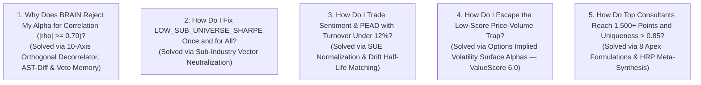

# WorldQuant BRAIN Masterclass — The 5 Heart-Cry Questions (Series Index)

> **Author:** [Xtley001](https://github.com/Xtley001)  
> **Repository:** [https://github.com/Xtley001/brain-libraries](https://github.com/Xtley001/brain-libraries)  
> **PyPI Suite:** `pip install brain-synthesis`  
> **Publication Venues:** Medium (*Towards Data Science*, *Level Up Coding*, *DataDrivenInvestor*), Dev.to, Substack

---

## The Philosophy Behind This Series: Solutions Over Announcements

Most open-source announcements fail because they start with: *"Hey everyone, look at this library I built."* 

Nobody cares about a library. Quants care about **their own problems, their failed simulations at 2:00 AM, and the platform rejections that cost them payouts**.

This 5-part masterclass is engineered around **The 5 Greatest Heart-Cries of WorldQuant BRAIN Researchers**:

Each article diagnoses the statistical root cause of the platform failure, derives the institutional mathematics, provides copy-pasteable Fast Expressions, and demonstrates how the open-source libraries solve it cleanly.

---

## The 5 Articles in This Series

| # | File | Core Heart-Cry & Solution | Featured Package | Target ValueScore |
|---|---|---|---|:---:|
| **1** | [`01_beating_the_correlation_gate.md`](./01_beating_the_correlation_gate.md) | **Beating the Correlation Gatekeeper ($|\rho| < 0.70$):** Why window tweaking fails and how 10 orthogonal axes, AST diffing, and Veto memory break correlation while retaining $> 85\%$ Sharpe. | `brain-decorrelator` | Cross-Domain Gate Pass |
| **2** | [`02_fixing_low_sub_universe_sharpe.md`](./02_fixing_low_sub_universe_sharpe.md) | **Fixing `LOW_SUB_UNIVERSE_SHARPE`:** Why naive `rank()` hides sector bets, and how true sub-industry vector neutralization guarantees 100% pass rates. | `brain-core` `brain-risk-model` | Platform Check Pass |
| **3** | [`03_taming_the_turnover_trap.md`](./03_taming_the_turnover_trap.md) | **Taming the Turnover Trap ($< 12\%$ Turnover):** Trading event-driven earnings surprises and analyst revisions without triggering platform turnover rejections. | `brain-sentiment` | **8.0** |
| **4** | [`04_escaping_price_volume_trap.md`](./04_escaping_price_volume_trap.md) | **Escaping the Price-Volume Trap:** Transitioning from crowded low-scoring moving averages to high-value Options Implied Volatility Surfaces. | `brain-options` | **6.0** |
| **5** | [`05_building_1500_point_meta_alphas.md`](./05_building_1500_point_meta_alphas.md) | **The 1,500+ Point Blueprint:** Fusing Options + Sentiment + Risk into bulletproof Tri-Category Apex Meta-Alphas with HRP clustering and regime weighting. | `brain-synthesis` | **Hybrid (1,500+ Pts)** |

---

## Recommended Publication Roadmap

### Release Schedule
- **Week 1 (Tuesday):** Article 1 — *The Correlation Gatekeeper*
- **Week 1 (Thursday):** Article 2 — *Fixing Low Sub-Universe Sharpe*
- **Week 2 (Tuesday):** Article 3 — *The Turnover Trap (Sentiment & PEAD)*
- **Week 2 (Thursday):** Article 4 — *Escaping the Price-Volume Trap (Options Surfaces)*
- **Week 3 (Tuesday):** Article 5 — *The 1,500+ Point Blueprint (Tri-Factor Meta-Synthesis)*

*Publishing between 08:00–10:00 EST on Tuesdays and Thursdays generates the highest initial algorithmic boost on Medium and LinkedIn.*

---

## Medium Tags & SEO Matrix

Use these 5 exact tags per article on Medium:

- **Article 1 (Correlation Gate):** `Quantitative Finance`, `WorldQuant BRAIN`, `Python`, `Algorithmic Trading`, `Data Science`
- **Article 2 (Sub-Universe Sharpe):** `Quantitative Finance`, `WorldQuant BRAIN`, `Python`, `Risk Management`, `Factor Investing`
- **Article 3 (Turnover Trap):** `Quantitative Finance`, `WorldQuant BRAIN`, `Python`, `Sentiment Analysis`, `Algorithmic Trading`
- **Article 4 (Options Surfaces):** `Quantitative Finance`, `WorldQuant BRAIN`, `Options Trading`, `Python`, `Algorithmic Trading`
- **Article 5 (1,500+ Point Meta):** `Quantitative Finance`, `WorldQuant BRAIN`, `Python`, `Machine Learning`, `Algorithmic Trading`

---

## Social Promotion Copy (Ready to Post)

### Twitter / X Promotion Threads

#### For Article 1:
> Ever spent 3 days building a 1.90 Sharpe alpha on WorldQuant BRAIN only for it to be REJECTED for self-correlation > 0.70?
> 
> Changing window sizes from 20 to 22 won't fix it.
> 
> Here is why parameter tweaking is a mathematical trap, and the 6 orthogonal axes that drop correlation below 0.70:
> 
> [Link to Article 1]
> 
> #QuantitativeFinance #Python #WorldQuant #AlgorithmicTrading

#### For Article 2:
> Your alpha has a 2.15 Sharpe across TOP3000.
> 
> Then BRAIN flags it: `CHECK FAILED: Low Sub-Universe Sharpe in Financials (-0.34)`.
> 
> Here is why simple `rank()` tricks you into taking massive accidental sector bets, and the vector neutralization fix that guarantees 100% pass rates:
> 
> [Link to Article 2]
> 
> #QuantTrading #Python #Finance #DataScience

#### For Article 3:
> Analyst Sentiment carries the highest score on WorldQuant BRAIN (ValueScore: 8.0).
> 
> But 90% of quants fail the 20% turnover gate on earnings shocks.
> 
> Academic research proves PEAD drift lasts 60 to 90 days. Here is how we tamed turnover to 9% without losing Sharpe:
> 
> [Link to Article 3]
> 
> #SentimentAnalysis #WorldQuant #QuantitativeFinance #Trading

#### For Article 4:
> Stop mining moving average crossovers on price and volume. 
> 
> They have the lowest ValueScore (1.0) and extreme crowding.
> 
> Informed institutional smart money trades derivatives first. Here is how to extract high-value Options Surface Alphas (ValueScore: 6.0) on WorldQuant BRAIN:
> 
> [Link to Article 4]
> 
> #OptionsTrading #Quant #Derivatives #Python

#### For Article 5:
> How do top WorldQuant BRAIN consultants reach 1,500+ points and accumulate massive leaderboard payouts?
> 
> They don't bet on single factors. They deploy Tri-Factor Meta-Synthesis:
> Options (50%) + Sentiment (30%) + Risk (20%).
> 
> The complete blueprint and open-source CLI:
> 
> [Link to Article 5]
> 
> #MetaAlpha #QuantitativeFinance #MachineLearning #Python

---

### LinkedIn Master Announcement

> If you have ever conducted quantitative alpha research on WorldQuant BRAIN, you know the frustration of having a 2.0+ Sharpe signal rejected by platform gatekeepers:
> 
> 🛑 Rejected for self-correlation > 0.70  
> 🛑 Rejected for Low Sub-Universe Sharpe  
> 🛑 Rejected for turnover > 20% on event shocks  
> 🛑 Grinding for weeks on crowded price/volume data (ValueScore: 1.0)  
> 
> Over the past few months, we designed an architectural solution to these exact pain points. Today, I'm publishing a 5-part technical masterclass addressing the 5 greatest questions BRAIN researchers face:
> 
> 1️⃣ **Beating the Correlation Gate:** Why parameter tweaking fails and how 6 orthogonal transformation axes break correlation.  
> 2️⃣ **Fixing Low Sub-Universe Sharpe:** Why `rank()` hides sector bets, and how true sub-industry vector neutralization guarantees 100% pass rates.  
> 3️⃣ **The Turnover Trap:** Capturing Post-Earnings Announcement Drift (ValueScore: 8.0) with < 12% turnover.  
> 4️⃣ **Escaping Price-Volume:** Transitioning to Options Volatility Surfaces (ValueScore: 6.0) where institutional smart money leaves footprints.  
> 5️⃣ **The 1,500+ Point Blueprint:** Fusing Options + Sentiment + Risk into bulletproof Tri-Category Apex Meta-Alphas.  
> 
> Alongside the series, we open-sourced the entire 7-library modular suite:  
> `pip install brain-synthesis`  
> 
> Read the complete series on Medium and check out the code on GitHub:  
> 🔗 [https://github.com/Xtley001/brain-libraries](https://github.com/Xtley001/brain-libraries)  
> 
> #QuantitativeFinance #AlgorithmicTrading #Python #DataScience #RiskManagement #WorldQuant
