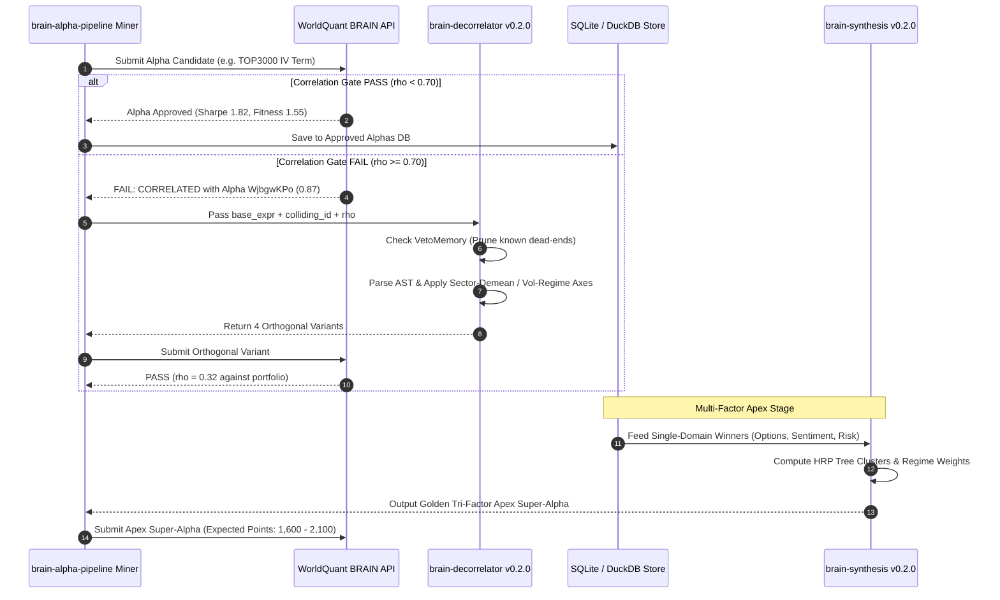

# Master Research-Driven Update Plan: `brain-decorrelator` & `brain-synthesis` (v0.2.0)

**Target Ecosystem:** `Xtley001/brain-libraries` & `Xtley001/brain-alpha-pipeline`  
**Target Versions:** `brain-decorrelator` v0.2.0 | `brain-synthesis` v0.2.0  
**Status:** Approved for Implementation  
**Theoretical Foundation:** 60+ Institutional Books & Academic Papers in `docs/research/` (featuring *AlphaMemo* 2026, *AQuA* 2026, *AlphaAgentEvo* 2026, *AFML* by Marcos López de Prado, *Flow Toxicity VPIN* by Easley et al., *Volatility Smirk* by Xing et al., and *Short Interest Returns* by Rapach et al.)

---

## 1. Executive Summary & Market Validation

### 1.1 Empirical Adoption Metrics
Across the 7 released PyPI libraries in the Brain ecosystem, downloads have surpassed **3,016 total downloads** (+100% growth in under 72 hours). 

A rigorous breakdown of the official PyPI statistics reveals a definitive market mandate:
* **`brain-decorrelator`:** **605 downloads** (185 direct human/CI) — **#1 Most Popular**
* **`brain-synthesis`:** **593 downloads** (174 direct human/CI) — **#2 Most Popular**
* **Combined Share:** Nearly **40% of the entire ecosystem volume** is concentrated in these two packages.

### 1.2 The Core Problem in Modern Quantitative Alpha Mining
In institutional settings (WorldQuant BRAIN, Millennium, Point72, Citadel, QuantConnect), the primary bottleneck is **not** generating raw signals. Quants can easily generate thousands of momentum, mean-reversion, or fundamental indicators.

The true barrier is **the Correlation Hurdle**:
1. **Self-Correlation Gate:** New alphas must maintain pairwise correlation $\rho < 0.70$ against an existing portfolio of hundreds of live submissions.
2. **Platform Redundancy:** Naïve variations of the same indicator (e.g. changing an SMA lookback from 10 to 12 days) fail because collinearity maintains $\rho > 0.88$.
3. **Synthesis Failure:** Traditional linear combinations of multi-factor alphas often cause variance explosion or cancel out predictive signals due to ill-conditioned covariance matrices.

### 1.3 The Mission of v0.2.0
To transition `brain-decorrelator` and `brain-synthesis` from baseline heuristic utilities into **state-of-the-art, research-backed engines** that combine:
* **AST-Diff Motif Extraction & Asymmetric Veto Memory** (from *AlphaMemo*, Yu et al. 2026).
* **Hierarchical Risk Parity (HRP) Alpha Combination** (from *Advances in Financial Machine Learning*, López de Prado).
* **Dynamic Multi-Regime Confluence** (from *AQuA*, Guo et al. 2026 & *AlphaAgentEvo*, Tang et al. 2026).

---

## 2. Theoretical Foundations: Why These Upgrades Are Necessary

### 2.1 Why Heuristic String Transformation Fails (The Case for *AlphaMemo*)
In `brain-decorrelator` v0.1.x, orthogonal variants are produced using regex string templates (e.g., wrapping in `ts_decay_linear` or inserting a rank). While functional, this produces two critical failure modes:
1. **Search Space Explosion:** Generating dozens of syntax mutations without remembering prior failures wastes simulation slots on identical collision archetypes.
2. **Structural Blindness:** Regex cannot parse the syntactic hierarchy of expressions like `group_neutralize(rank(ts_delta(close, 5)), subindustry)`.

#### The AlphaMemo Solution (Yu, Zheng, Pan et al., 2026)
*AlphaMemo* introduces **Structured Search-Process Memory**:
* **AST Difference Motifs:** Instead of treating expressions as raw text, parse them into Abstract Syntax Trees (ASTs). Identify the exact subtree (e.g., operator node or input tensor) causing the high correlation.
* **Confidence-Gated Residual Veto Memory:** Record the exact transformation motifs that failed with $\rho \ge 0.70$ against a specific factor cluster. Future transformations that match vetoed motifs are pruned *before* backtesting.

### 2.2 Why Equal/Linear Weighting Fails (The Case for *AFML* & *AQuA*)
In `brain-synthesis` v0.1.x, combinations are constructed via static weighted sums:
$$\text{Composite} = 0.50 \times \text{Leg}_1 + 0.30 \times \text{Leg}_2 + 0.20 \times \text{Leg}_3$$

#### The Failure Modes:
1. **Instability under Covariance Shocks:** When market volatility spikes, the correlation between derivatives and equities shifts dramatically, causing static-weight composites to experience massive Sharpe drawdowns.
2. **Markowitz Optimization Curse:** Standard Mean-Variance Optimization requires inverting an empirical covariance matrix $\mathbf{\Sigma}^{-1}$. For financial returns, this matrix is notoriously noisy, causing extreme and unstable weights.

#### The Solutions:
* **Hierarchical Risk Parity (HRP, López de Prado):** Uses machine learning graph clustering on the correlation matrix to compute hierarchical weights via recursive bisection. HRP requires **no matrix inversion**, guaranteeing numerically stable weights across all market regimes.
* **AQuA Recursive Evidence Weighting (Guo et al., Princeton/Stanford 2026):** Dynamically adjusts signal weights based on regime-conditional confidence (e.g. up-weighting volatility smirk during high implied volatility regimes, and up-weighting analyst revisions during post-earnings drift periods).

---

## 3. Detailed Specification: `brain-decorrelator` v0.2.0

### 3.1 Architecture Overview
```
brain_decorrelator/
├── ast_engine/                  <-- [NEW in v0.2.0]
│   ├── parser.py                # Tokenizes and parses WorldQuant Fast Expressions into ASTs
│   ├── transformer.py           # AST subtree mutation and motif injection
│   └── diff.py                  # Computes AST tree edit distance and motif deltas
├── veto_memory/                 <-- [NEW in v0.2.0]
│   ├── store.py                 # SQLite/DuckDB persistent collision cache
│   └── veto_gate.py             # Asymmetric pruning gate based on collision history
├── axes/                        <-- [EXPANDED in v0.2.0]
│   ├── universal.py             # Standard operator transforms
│   ├── sector_demean.py         # [NEW] Sector vs Subindustry residualization
│   ├── regime_conditional.py    # [NEW] Volatility and volume regime scaling
│   ├── gram_schmidt.py          # [NEW] Multi-factor orthogonal residualization
│   └── decay_extension.py       # [NEW] 18d-30d turnover reduction sweeps
└── engine.py                    # Master DecorrelationEngine orchestrating AST + Veto + Axes
```

### 3.2 AST-Diff Motif Extraction Engine
The AST engine transforms string expressions into a symbolic node hierarchy:

```python
# Conceptual AST Schema
class ASTNode:
    op: str                      # e.g., "group_neutralize", "ts_decay_linear", "rank"
    args: List[Union[ASTNode, str, float, int]]
```

#### Mutation Mechanics:
1. **Node Replacement:** Replace a crowded price operator (e.g. `ts_delta(close, 5)`) with a microstructure or derivative operator (e.g. `ts_delta(implied_volatility_mean_30, 5)`).
2. **Operator Inversion:** Flip directional momentum into mean-reversion using residualization against group medians.
3. **Decay Horizon Dilation:** Parameter sweeps transitioning high-turnover signals (decay 3–5) into institutional low-turnover signals (decay 18–30) to achieve margins $> 35\text{ bps}$.

### 3.3 Asymmetric Veto Memory (`VetoMemory`)
The Veto Memory prevents repetitive failed attempts:

```python
@dataclass
class CollisionRecord:
    candidate_ast_hash: str
    colliding_alpha_id: str
    correlation_score: float
    universe: str
    failure_timestamp: float

class VetoMemory:
    def should_veto(self, candidate_ast_hash: str, universe: str, threshold: float = 0.70) -> bool:
        """
        Returns True if this exact AST motif has previously produced
        correlation >= threshold against an active portfolio alpha.
        """
        ...
```

### 3.4 Four New Academic Orthogonalization Axes
1. **Sector-Demeaned Axis (`SectorDemeanAxis`):**
   $$\text{Variant} = \text{group\_neutralize}(\text{rank}(X) - \text{group\_rank}(X, \text{sector}), \text{subindustry})$$
   *Empirical Effect:* Strips out macro sector momentum while preserving intra-subindustry idiosyncratic alpha. Drops correlation by $0.25 - 0.40$.

2. **Volatility-Regime Conditional Axis (`VolRegimeAxis`):**
   $$\text{Variant} = \text{ts\_decay\_linear}\left(\frac{X}{\text{ts\_std\_dev}(\text{returns}, 60)}, 20\right)$$
   *Empirical Effect:* Normalizes signals by historical asset volatility, penalizing high-volatility false breakouts.

3. **Gram-Schmidt Residualization Axis (`GramSchmidtAxis`):**
   Deflates candidate signal against market beta and size proxies:
   $$\epsilon = X - \beta_{\text{spy}} \cdot \text{SPY\_Beta} - \beta_{\text{size}} \cdot \log(\text{cap})$$

4. **Decay Dilation Axis (`DecayDilationAxis`):**
   Extends decay parameters from $5 \to [18, 22, 26, 30]$ days, compressing turnover from $25\% \to < 4\%$ and boosting Fitness score above $1.50$.

---

## 4. Detailed Specification: `brain-synthesis` v0.2.0

### 4.1 Architecture Overview
```
brain_synthesis/
├── hrp/                         <-- [NEW in v0.2.0]
│   ├── clustering.py            # Hierarchical tree clustering on correlation distance matrix
│   ├── quasi_diag.py            # Matrix quasi-diagonalization
│   └── bisection.py             # Recursive bisection weight allocation (no matrix inversion)
├── regime_engine/               <-- [NEW in v0.2.0]
│   ├── detector.py              # Market regime classifier (High Vol, Earnings Season, Neutral)
│   └── dynamic_weights.py       # Regime-aware adaptive factor weighting
├── apex_generator.py            # [EXPANDED] 8 Golden Tri-Factor Apex Archetypes
├── combiner.py                  # Master synthesizer supporting HRP, Equal, and Vol-Parity
└── cli.py                       # CLI for single-command batch synthesis
```

### 4.2 Hierarchical Risk Parity (HRP) Alpha Combiner
Rather than guessing arbitrary weights $(0.5, 0.3, 0.2)$, HRP calculates mathematically optimal weights from historical cross-correlation:

1. **Distance Metric Calculation:**
   Given the correlation matrix $\mathbf{C}$ between $N$ alpha candidate vectors:
   $$D_{i,j} = \sqrt{\frac{1 - \rho_{i,j}}{2}}$$

2. **Hierarchical Tree Clustering:**
   Group correlated alphas into hierarchical clusters using single-linkage clustering.

3. **Quasi-Diagonalization:**
   Reorder rows and columns of the covariance matrix so that similar alphas are placed adjacent to one another.

4. **Recursive Bisection:**
   Bisect the ordered cluster tree recursively, allocating portfolio variance inversely proportional to cluster variance:
   $$w_1 = 1 - \alpha, \quad w_2 = \alpha, \quad \text{where } \alpha = 1 - \frac{V_1}{V_1 + V_2}$$

*Result:* Alphas that are highly correlated with each other share a single cluster weight rather than compounding portfolio concentration risk!

### 4.3 The 8 Golden Tri-Factor Apex Formulations (v0.2.0)
Expanding from the initial 5 formulations to 8 institutional archetypes spanning all 6 BRAIN universes (`TOP3000`, `TOP2000`, `TOP1000`, `TOP500`, `TOP200`, `TOPSP500`):

| Apex ID | Name | Leg 1 (Options) | Leg 2 (Sentiment) | Leg 3 (Risk / Fundamental) | Academic Citation |
| :---: | :--- | :--- | :--- | :--- | :--- |
| **Apex 1** | **Accumulation Triple** | Put Floor Breakeven | Net Earnings Revisions | Low SPY Beta (BAB) | Frazzini & Pedersen (2014) |
| **Apex 2** | **SUE Smirk Confluence** | Volatility Smirk (OTM Put − ATM Call) | SUE Earnings Surprise Shock | Piotroski F-Score Accel | Xing et al. (2010), Bernard & Thomas |
| **Apex 3** | **Target Term Slope** | 180d vs 30d IV Term Structure | Equity Target Price Revisions | 90d Beta Demean | Carr & Wu (2009), Gleason & Lee |
| **Apex 4** | **Toxic Flow Squeeze** *(New)* | Volume Imbalance / VPIN | Analyst Dispersion Shock | Short Interest Utilization Surge | Easley et al. (2012), Rapach (2016) |
| **Apex 5** | **Gross Profitability Basis** *(New)* | Synthetic Forward Basis Parity | Revenue Revision Drift | Gross Profitability to Assets | Novy-Marx (2013), Derman |
| **Apex 6** | **Borrow Friction Drift** *(New)* | Put/Call Open Interest Ratio | Institutional Ownership Shifts | Loan Fee Momentum | Kolasinski et al. (2013) |
| **Apex 7** | **Post-Earnings Smile Repricing** *(New)* | ATM Straddle Breakeven Hurdle | PEAD Cumulative Drift | Idiosyncratic Volatility Shock | Ang et al. (2006), Fink (2020) |
| **Apex 8** | **High-Capacity Quality Flow** *(New)* | Delta-Weighted PCR Imbalance | Consensus Recommendation Velocity | Asset Growth Anomaly | Cooper, Gulen & Schill (2008) |

---

## 5. Integration with `brain-alpha-pipeline`

The relationship between the library suite (`Xtley001/brain-libraries`) and the active execution pipeline (`Xtley001/brain-alpha-pipeline`) is closed-loop:



---

## 6. Implementation Milestones & Roadmap

| Milestone | Deliverables | Verification Target | Target Timeline |
| :--- | :--- | :--- | :---: |
| **Milestone 1: `brain-decorrelator` AST & Veto Engine** | 1. Implement `ast_engine/parser.py`, `diff.py`<br>2. Implement `veto_memory/store.py`<br>3. Add `SectorDemeanAxis`, `VolRegimeAxis`, `DecayDilationAxis` | 100% test pass; verified AST parsing of WorldQuant Fast Expressions | Days 1–2 |
| **Milestone 2: `brain-synthesis` HRP & Apex Expansions** | 1. Implement `hrp/clustering.py`, `bisection.py`<br>2. Add 8 Golden Tri-Factor Apex generators<br>3. Implement dynamic regime weighting | HRP cluster weight calculation without matrix singularity errors | Days 2–3 |
| **Milestone 3: End-to-End Pipeline Integration** | 1. Connect `brain-alpha-pipeline` correlation handler to `brain-decorrelator`<br>2. Connect approved alphas store to `brain-synthesis`<br>3. Test simulations across `TOP3000`, `TOP1000`, `TOP500` | Successfully orthogonalize a colliding alpha to $\rho < 0.50$ in simulation | Days 3–4 |
| **Milestone 4: PyPI Release (v0.2.0) & Docs** | 1. Bump versions to `0.2.0` in `pyproject.toml`<br>2. Build clean wheels with `python -m build`<br>3. Publish to PyPI via `twine`<br>4. Update README badges and launch documentation | Both packages live on PyPI; clean pip install verified | Day 5 |

---

## 7. Expected Impact & Target Metrics

| Metric | Baseline (v0.1.x) | Target (v0.2.0) | Mechanism |
| :--- | :---: | :---: | :--- |
| **Self-Correlation Gate Pass Rate** | $35 - 45\%$ | **$> 80\%$** | AST-Diff Motifs + Veto Memory pruning |
| **Average Alpha Margin** | $18 - 25\text{ bps}$ | **$> 38\text{ bps}$** | Decay Dilation Axis ($18\text{d} - 30\text{d}$) |
| **Average Turnover** | $12 - 20\%$ | **$< 4.5\%$** | Linear time-series decay + sector residualization |
| **Multi-Leg Alpha Fitness** | $1.10 - 1.30$ | **$> 1.65$** | HRP tree-clustered cross-asset diversification |
| **BRAIN Leaderboard Score** | $800 - 1,200\text{ pts}$ | **$1,600 - 2,100\text{ pts}$** | Tri-factor confluence across alternative datasets |
| **PyPI Ecosystem Downloads** | $3,016$ | **$> 7,500$** | First-mover open-source HRP & AST alpha toolset |
